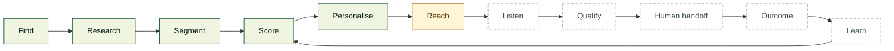
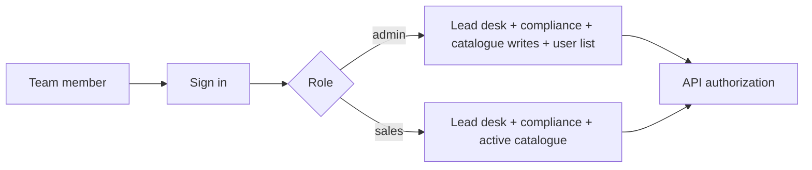
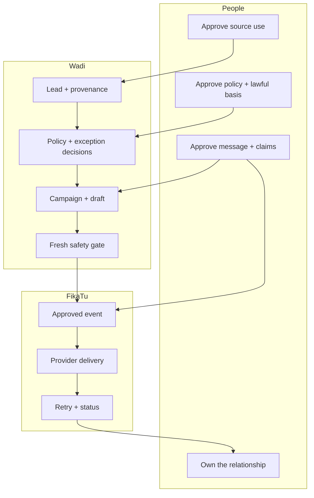
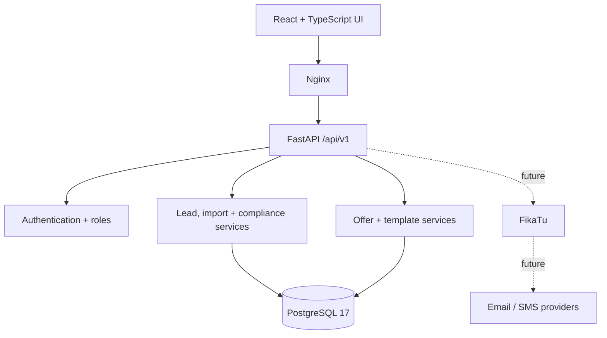
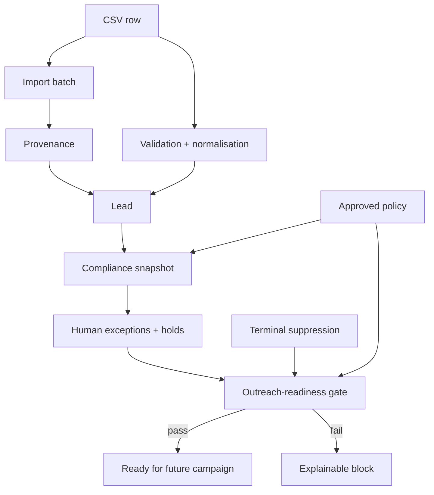

# Wadi — full project guide

**Updated:** 2026-11-09 · **Planning posture:** Sprints 1–4 closed; Sprint 5 in contract review

This is the complete, skimmable view of Wadi: why it exists, what works today, how the pieces
fit, what stops the flow, and what comes next. Start with the
[visual workflow](workflow.html); come here when you need project status,
architecture, history or roadmap context.

| I need to… | Read |
|---|---|
| understand the whole product quickly | this page, sections 1–4 |
| understand one lead's exact path | [workflow description](workflow-description.md) |
| see what is being reviewed now | [Sprint 5 campaigns and drafts](delivery/sprint-5-campaigns-drafts.md) |
| check legal and outreach rules | [compliance foundation](compliance/README.md) |

## 1. What Wadi is

Wadi is Webloom + Innovations' sales scout. It turns a researched market into reviewed,
human-ready sales opportunities.

Websites are the first offer. The same lead-to-outcome system can later sell FikaTu, ERP,
automation, AI and other services.

The product principle:

> Automate the repeatable 80%. Keep human judgement in the important 20%.

Wadi is not an auto-dialler or a bulk-message tool. It records evidence, creates useful
targeting decisions and prepares outreach that a person still owns.

## 2. The complete product loop



“Built” here means Wadi can handle the corresponding sales data or decision. It does not
mean every future automation exists. For example, intake and personalisation data exist, but
campaign generation does not.

## 3. You are here

```mermaid
flowchart LR
    A[Lead intake] --> B[Evidence + compliance]
    B --> C[Approved policy + exception review]
    C --> D[Readiness gate]
    D --> E[Offer + template catalogue]
    E -. Sprint 5 .-> F[Campaign + draft]
    F -. Sprint 6 .-> G[Human approval]
    G -. Sprint 6 .-> H[FikaTu delivery]

    classDef built fill:#eff5e0,stroke:#084734,color:#0b1f18;
    classDef current fill:#b4d665,stroke:#084734,color:#0b1f18;
    classDef future fill:#ffffff,stroke:#9aa9a0,color:#3d5148,stroke-dasharray:5 4;
    class A,B,C,D built;
    class E current;
    class F,G,H future;
```



**Current boundary:** Wadi can collect a lead, preserve evidence, apply a central approved
policy, route genuine exceptions for human review, test outreach readiness, and maintain
offers/templates.

**Not built:** campaigns, rendered drafts, approval queue, sending, FikaTu dispatch, delivery
status, retries, replies and outcomes.

There is deliberately no send path. A readiness result does not approve a message.

## 4. Status at a glance

| Area | Status now |
|---|---|
| Authentication and `admin`/`sales` roles | Built |
| Lead list, detail, activity and responsive Lead Desk | Built |
| CSV import with row-level refusals | Built |
| Provenance, duplicate and terminal suppression handling | Built |
| Durable compliance evaluations and stale-input detection | Built |
| Central policy, exception review and outreach-readiness check | Built; approved SMS policy enabled for Yellow Pages Kenya generic business contacts |
| Offers, prices, email/SMS templates and variable validation | Sprint 4 closed with accepted deviations |
| Campaigns, segments and rendered drafts | Sprint 5 |
| Approval queue and FikaTu delivery | Sprint 6 |
| Replies, qualification and human handoff | Sprint 7 |
| Outcomes, reporting and learning | Sprint 8 |
| Pilot deployment and hardening | Sprint 9 |

## 5. Who uses Wadi



| Role | Current access |
|---|---|
| `admin` | Lead Desk, import, compliance review, user list, offer/template writes |
| `sales` | Lead Desk, import, compliance review, active offer/template reads |

Both roles can see contact details because both work the lead desk. There is no public user,
customer portal or separate sales-manager role yet.

## 6. Responsibilities and boundaries



Wadi owns sales state and decisions. FikaTu owns delivery mechanics. People own the parts
that require judgement or a relationship.

## 7. Runtime architecture



Current runtime facts:

- PostgreSQL stores leads, activity, imports, provenance, compliance, suppression, users,
  offers and templates.
- The versioned policy file is `backend/app/config/compliance_policy.json`; policy
  `2026-11-09.1` enables SMS for Yellow Pages Kenya generic business contacts under
  `legitimate_interests`.
- Alembic owns reversible migrations `0001`–`0005`.
- JWT authentication protects every business endpoint; `admin` writes and `sales` reads are
  enforced by the API.
- Nginx serves the React app and proxies `/api` to FastAPI.
- Docker Compose starts the database, API and frontend together.
- Synthetic lead seeding is opt-in through `SEED_SAMPLE_DATA=true`.

## 8. One lead's evidence chain



The system preserves the reason, decision type, policy or reviewer reference and assessed input
state. When contact, provenance, purpose, policy version or review data changes, the previous
decision can become stale.

Detailed stage rules and stop conditions are in
[workflow-description.md](workflow-description.md).

## 9. What the sprints delivered

### Sprint 1 — first working slice

React shell, Lead List, Lead Detail, activity history, PostgreSQL, FastAPI, and one-command
local runtime.

### Sprint 2 — real Lead Desk

CSV import, row-level refusals, duplicate detection, import batches, provenance, independent
email/SMS/WhatsApp review records, terminal suppression, audit events, filters, search,
pagination and responsive Wadi identity.

### Sprint 3 — access and compliance foundation

Email/password login, API-enforced roles, forced temporary-password change, token revocation,
durable compliance evaluations, stale-input detection, bulk readiness checks, server-side
compliance filters, responsive card lists, and the explicit outreach boundary.

### Sprint 4 — offers and templates

Multi-currency offers, Starter Website at KES 40,000, open commercial pricing for discovery
offers, email/SMS templates with variants, allowlisted variables, mandatory `{{opt_out}}`,
Admin management, Sales read-only access, responsive catalogue cards, accessible add/edit
dialogs, migration `0005` and an idempotent catalogue seed.

**Status:** closed. Catalogue PR #29 and final sprint PR #30 are merged. Closeout fixes reject
raw contact details, hide templates under inactive offers from Sales, and expand UI coverage.
Accepted deviations include the partial copy pack, open non-Starter pricing, and the responsive
card-grid layout.

## 10. What is ready to sell

The catalogue seed currently describes:

| Offer | Current price guidance |
|---|---|
| Starter Website | **KES 40,000** |
| Business Website | Open; no price invented |
| Custom Website | Open; no price invented |
| FikaTu Notification Platform | Open; no price invented |

An offer is editable commercial data. A template is approved reusable copy. Neither is a
campaign or permission to send.

## 11. Known gaps and carry-forward decisions

These are real and must not be mistaken for completed work:

1. The central policy content, lawful-basis decision, DPIA/registration, retention policy,
   processor terms and final opt-out wording remain human inputs.
2. Imported provenance can still be weak when source URL or intended-purpose detail is absent.
3. Campaigns, rendered drafts, approval and delivery do not exist yet.
4. FikaTu has no `sales.outreach.send` event type yet.
5. WhatsApp eligibility can be recorded, but FikaTu has no WhatsApp provider.
6. Inbound replies and automatic opt-out capture are absent.
7. Login rate limiting, lockout and login-attempt auditing remain hardening work.
8. All four local bootstrap users are Admins; final Admin/Sales allocation is a team decision.
9. The 13-screen product inventory is not formally signed off.
10. Business, Custom and FikaTu offer prices remain open.
11. Sprint 4 is closed; its limitation register and accepted carry-forward work are in the
    [exit review](homework/sprint-4/status.md).
12. Central automatic eligibility is enabled for the approved SMS rule only. Every new source,
    purpose, contact type or channel requires its own approved policy.

## 12. Roadmap


### Sprint 5 — campaigns and drafts

Segments and explicit lead selections, campaign intent, one offer/template per campaign,
rendered draft snapshots, and a visible skip reason for every ineligible lead.

The [Sprint 5 technical review](delivery/sprint-5-campaigns-drafts.md) lists the campaign,
segment, role, copy and idempotency decisions still required.

### Sprint 6 — approval and delivery

Approval queue, FikaTu event registration, a fresh compliance check before every attempt and
retry, idempotency, pacing and delivery status.

### Sprint 7 — replies and human handoff

Reply capture, objection classification, qualification, ownership and follow-up cadence.
Automation stops when a person takes over.

### Sprint 8 — outcomes and learning

Deals, source/sector/offer/variant reporting, win-loss reasons and audited exports.

### Sprint 9 — pilot and hardening

One real sandbox campaign, deployment, monitoring, backups, restore verification, security
review and a pilot retrospective.

The full ownership and sprint detail remain in [Sprint plan](delivery/sprint-plan.md). This
guide does not replace sprint contracts or deep specifications.

## 13. Run and verify

```bash
docker compose up -d --build
docker compose exec api alembic upgrade head
docker compose exec api python -m app.catalog_seed

cd frontend
npm run lint && npm test && npm run build
```

Useful local URLs:

- App before login: <http://localhost:5174/>
- Direct public workflow: <http://localhost:5174/workflow.html>
- API documentation: <http://localhost:8001/docs>

The exact current test counts, commit and manual acceptance status belong in the Sprint 4 PR
and review homework, not duplicated here.

## 14. Source map

| Topic | Authoritative source |
|---|---|
| Stage-by-stage lead journey | [workflow-description.md](workflow-description.md) |
| Product scope and long-term intent | [Scope spec](superpowers/specs/2026-10-08-webloom-sales-engine-scope.md) |
| Sprint order, ownership and estimates | [Sprint plan](delivery/sprint-plan.md) |
| Detailed backlog | [Sprint detail](delivery/sprint-detail.md) |
| Closed offers/templates contract | [Sprint 4 contract](delivery/sprint-4-offers-templates.md) · [exit review](homework/sprint-4/status.md) |
| Sprint 5 review and open decisions | [Campaigns and drafts](delivery/sprint-5-campaigns-drafts.md) |
| Compliance rules and SOP | [Compliance](compliance/README.md) · [Outreach SOP](compliance/outreach-sop.md) |
| FikaTu capabilities and gaps | [FikaTu research](research/2026-10-08-fikatu-integration-notes.md) |
| Team working agreement | [How we work](team/how-we-work.md) |
| Current team assignments | [Homework](homework/README.md) |
