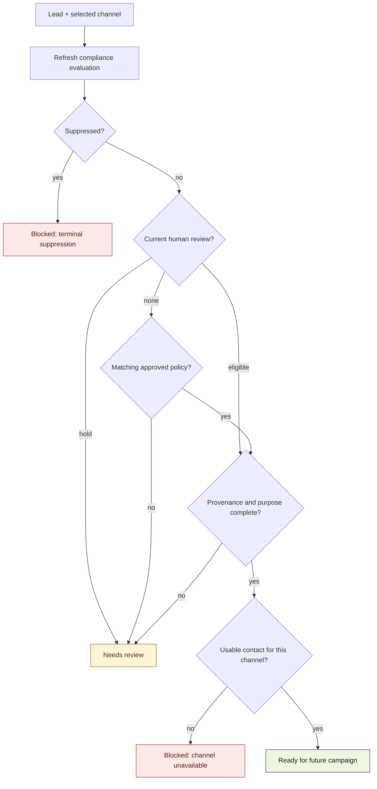
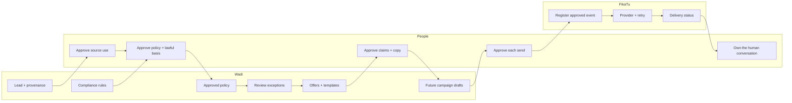

# Wadi workflow

**Purpose:** explain one lead's journey through Wadi, the decisions Wadi can make, the
decisions a person must make, and the exact point where the current product stops.

This is the stage contract. The [visual workflow](workflow.html) is the
five-minute orientation; the [full Wadi guide](full-wadi-documentation.md) covers project
status, architecture, gaps and roadmap.

## The route


**Sprint 4 adds the commercial building blocks:** offers and reusable email/SMS templates.
It does not connect those blocks into a campaign. The implemented boundary remains the
outreach-readiness gate.

## Stage contract

| Stage | Status | Wadi does | A person decides | Continues when | Stops when |
|---|---|---|---|---|---|
| **0. Access** | Built | Authenticates the user, loads `admin` or `sales`, requires a changed temporary password | Who receives an account and which role they hold | Session and role are valid | `401` or `403` |
| **1. Intake** | Built | Reads the CSV, validates rows, normalises contacts and reports row-level reasons | Whether the research source is appropriate to use | Rows are valid and accepted | The file or row is malformed, duplicate or suppressed |
| **2. Evidence** | Built | Preserves provenance, contact availability and data-quality state | Whether the evidence is credible and complete enough | The lead can be reviewed | Required provenance or contact evidence is missing |
| **3. Compliance** | Built | Applies the central approved policy, records reason codes and fingerprints the assessed inputs and policy version | Whether the central policy is valid for this source, purpose and channel | A current policy or human decision supports the channel | Suppression blocks it, evidence is incomplete, or no policy matches |
| **4. Exceptions** | Built | Records human decisions, holds, reviewer identity and terminal suppression | Genuine exceptions and any manual override | A current human review or approved policy supports that channel | Public contact details alone are treated as permission, or a decision is stale |
| **5. Readiness gate** | Built | Re-evaluates the lead and checks the selected channel immediately | Whether to prepare a future campaign | The channel is currently eligible | Any evidence, contact, purpose or suppression check fails |
| **6. Catalogue** | Sprint 4 | Stores offers, prices, pitch angles, email/SMS templates and validated variables | What is sold, how it is described and whether copy is active | Offer and template are active and valid | Copy has unknown variables, raw contact data or no `{{opt_out}}` |
| **7. Campaign + draft** | Sprint 5 | Builds a segment, snapshots the offer/template and renders one draft per eligible lead | Audience and campaign intent | Each draft has complete variables and a recorded skip reason where needed | A lead fails the fresh gate |
| **8. Approval + delivery** | Sprint 6 | Requires approval, checks again at send time and hands an event to FikaTu | The exact message and audience | Current approval and current eligibility agree | Approval is stale, a lead is suppressed, or delivery is technically unavailable |
| **9. Reply + handoff** | Sprint 7 | Records replies, classifies objections and stops automation at human ownership | How to qualify and who takes over | A seller owns the conversation | A person has taken over or the contact opts out |
| **10. Outcome + learning** | Sprint 8 | Records deals and compares source, sector, offer and variant performance | What the outcome means and what to try next | Outcome data is complete | Results are used to bypass human approval or compliance |

## What happens to a failing lead

The gate is intentionally boring: every refusal must be explainable.



**Readiness is not approval.** It answers only “may this channel be considered now?” It does
not approve a message, a campaign or a send.

## Responsibility boundary



Wadi owns sales decisions and evidence. FikaTu owns delivery mechanics. People own source
acceptance, legal basis, message approval and the relationship.

## Built versus planned

| Layer | Built now | Not built |
|---|---|---|
| Sales data | Lead Desk, activity history, CSV import, provenance, search, filters, pagination | Lead editing, ownership, lifecycle automation |
| Compliance | Central versioned policy, independent channel results, exception reviews, stale-input detection, suppression, outreach checks and audit events | Final legal policy content, automatic opt-out capture, send-time enforcement |
| Commercial data | Offers, multi-currency prices, email/SMS templates, variants and variable validation | Campaign selection, rendered drafts, template version history |
| Outreach | Readiness evidence only | Approval queue, sending, FikaTu events, delivery status, retries |
| Learning | None yet | Replies, qualification, deals, reporting and targeting feedback |

## Non-negotiable rules

1. **A human approves every send.** Automation may prepare; it may not approve.
2. **Suppression is terminal.** It overrides a saved review at every future gate.
3. **Public contact data is not permission.** Lawful basis must be approved centrally or
   recorded in a human review.
4. **Missing evidence stays visible.** Wadi does not fill gaps by assumption.
5. **The API is authoritative.** Hidden controls are not access control.
6. **Wadi owns sales decisions; FikaTu owns delivery.**
7. **Every dispatch rechecks state.** An earlier approval cannot rescue stale or suppressed data.

## Where the current workflow ends

```text
CSV → lead + provenance → approved policy / exception review → outreach-readiness gate
                                                            └── stops here

Sprint 4 catalogue:
offer + template → available for Sprint 5
                  └── no campaign or send path
```

Detailed operating rules remain in [Compliance](compliance/README.md). Delivery
research and current FikaTu gaps remain in
[FikaTu integration notes](research/2026-10-08-fikatu-integration-notes.md).

## Related orientation

- [Visual workflow](workflow.html) — the compact public orientation page.
- [Full Wadi documentation](full-wadi-documentation.md) — project status, architecture and roadmap.
- [Sprint 4 contract](delivery/sprint-4-offers-templates.md) — the closed catalogue slice.
- [Sprint 5 contract](delivery/sprint-5-campaigns-drafts.md) — the active slice.
- [Sprint 5 homework](homework/sprint-5/README.md) — Herman implements; Mark, Sharon and Anne
  review.
